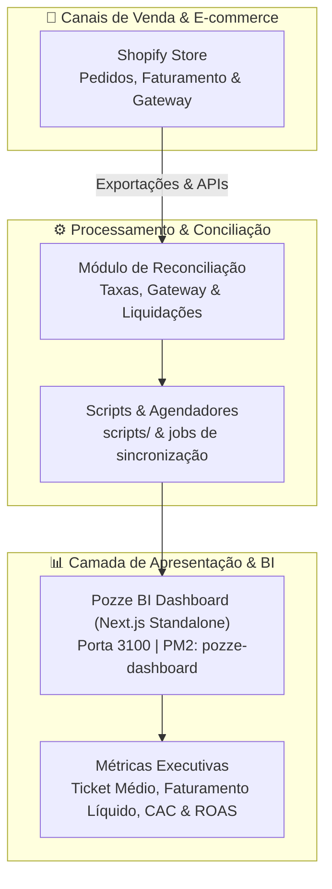

# ✨ Pozze — Business Intelligence & Gestão E-commerce

Bem-vindo ao hub central de tecnologia da **Pozze**. Esta organização reúne os repositórios, dashboards e ferramentas de conciliação analítica para a gestão de vendas e e-commerce da marca.

---

## 🏛️ Arquitetura do Sistema

---

## 📦 Repositórios

### 📊 [pozze](https://github.com/Pozze/pozze)
- **Função:** Plataforma unificada de Business Intelligence, Dashboard Executivo e Reconciliação Financeira de E-commerce.
- **Stack:** Next.js (App Router, Standalone), Tailwind CSS, PM2 (`pozze-dashboard`, porta 3100).
- **Ambientes:**
  - *Desenvolvimento (Workspace):* `/home/admapps/pozze/`
  - *Produção (Runtime):* `/var/www/pozze/`

---

## 🚀 Padrões de Desenvolvimento & Deploy

- **Branch Base:** `main`. Todo desenvolvimento ocorre em branch de feature (`feat/...` ou `fix/...`).
- **Deploy:** Deploy zero-downtime executado via `/var/www/pozze/deploy.sh` recarregando o PM2 com `PORT=3100`.
- **Commits:** Padronização com [Conventional Commits](https://www.conventionalcommits.org/).
